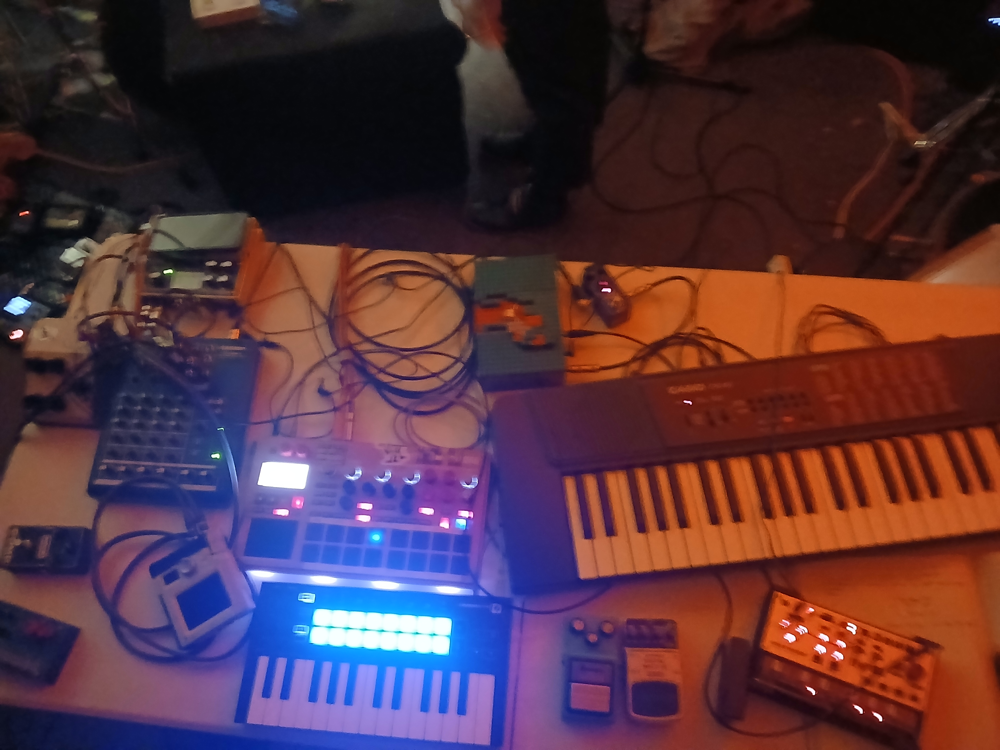

# H.E.A.T. practice table — 2026-10-05

This is a dated record of a recent practice-table configuration for work with **H.E.A.T.**, where the documented role is **keys / synth / noise player**.

It is not a claim that this is a complete solo-performance rig, a fixed H.E.A.T. stage plot, or a show-ready patch. It records one working arrangement used to develop parts, textures, transitions, and responsive playing within the group.

## Role in the group

The table supports a contributing player within H.E.A.T.:

- keyboard and synth material can support, answer, or contrast the ensemble;
- noise and small sound objects can supply texture, disruption, and transitions;
- the layout leaves room to react to shared dynamics, arrangements, and cues rather than assuming a self-contained set;
- final choices of clock, monitoring, mixer routing, and stage responsibilities remain collective, practice- or show-specific decisions.

## What the photo documents

Visible in this overhead view are:

- two compact keyboard/control surfaces;
- a pad-and-knob controller;
- several small desktop sound, processing, and noise objects;
- foot controls and a dense temporary cable layout.

The photograph is useful evidence of physical adjacency and working scale, not proof of signal routing, current MIDI assignments, device ownership, or reliable live status. Do not infer a complete patch from cable positions alone.

## Working boundaries

- No device in this photo is presumed to be H.E.A.T.'s clock authority.
- No device is presumed to feed a master mix, PA, or recording path without a separate practice/show patch record.
- Presence here does not promote an item to `core/live` in the studio rig or to a permanent H.E.A.T. role.
- Exact device IDs, connections, and power paths should be confirmed in a future annotated table pass before this becomes a rehearsal or performance checklist.

## Follow-up for the next table pass

1. Photograph the table in better light, with a second view of the rear/side connections.
2. Name each device and mark whether it is keys, synth voice, noise source, controller, processor, or utility.
3. Capture only the shared interfaces that matter to H.E.A.T.: audio handoff, monitoring, clock/tempo agreement, and any cue/control paths.
4. Record what was actually used in the practice and what was merely available on the table.

## Evidence

- `equipment/photos/heat-practice-table-2026-10-05.jpg`
- Original capture filename: `20261005_211106.jpg`
